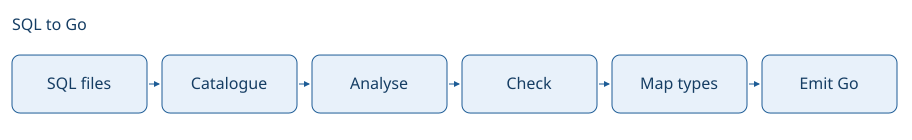

# From SQL to Go

Seagull treats SQL as source code. It learns the schema, checks the queries against it and writes the Go needed to bind parameters and read results.

## The schema gives a query its meaning

A query such as `SELECT title FROM tasks` does not say what type `title` has or whether it can be NULL. Seagull first builds a catalogue from the migrations, or reads one from a schema source. Query analysis then resolves names against that catalogue and the scopes introduced by joins, CTEs and subqueries.

The result is more than a list of columns. It records parameter types, result structure and the parts of SQL that a generated method may vary, such as a slice parameter or a sort choice. Diagnostics keep their source locations so a caller can connect a finding back to the SQL it wrote.

## Analysis and emission answer different questions

The dialect describes the database's SQL rules. The emitter describes the Go driver API. Keeping an analysed query between them lets native pgx and `database/sql` share PostgreSQL analysis while producing different calling code.

Go type mapping combines the inferred SQL types with configured overrides and emitter defaults. The naming plan gives the package one consistent set of declarations. Emission then writes methods using those types and names.

This boundary is also what makes Seagull useful inside another tool. `Catalogue` supplies schema information, while `Vet` checks the queries and, when a package is supplied, the emitter and generated names. Neither operation writes output.

## Diagnostics travel with the result

An unreadable file can stop an operation with a Go error. A SQL problem can instead appear in its report or result. An embedding tool needs to check both before it publishes generated code.

The CLI can leave a failing query out, write the rest of the package and still exit with a failure status. That keeps unaffected methods available without letting the error disappear from CI. A schema or package-level error stops generation for that database.

See [analysis guarantees](analysis-guarantees.md) for the limits of these checks, [architecture](architecture.md) for the package boundaries and the [generator API](../reference/generator-api.md) for the calling contract.
