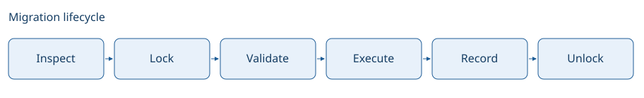

# Migration safety and recovery

A migration runner has to distinguish what has run, who may run next and what remains after interruption. Version history, checksums, locks and checkpoints answer different parts of that problem; none can substitute for the others.

## Transactions change the failure model

When the database can transact a complete migration with its history row, SQL effects and recorded completion can succeed or roll back together. Other engines and statements commit independently. A dirty history record then says work started, not that either all or none of the file took effect.

A statement checkpoint is another database write after the statement's effect. Outside a transaction spanning both, a process can stop between those writes. Progress reduces how much needs to be retried, but cannot prove that every statement after the checkpoint is untouched. Batching and failed checkpoint writes widen that gap.

The completed-prefix digest and splitter version guard a different risk: skipping statements whose boundaries changed. They establish that recorded progress still refers to the same prefix; they do not establish the database's unrecorded effects. This is why recovery needs inspection as well as a resume index.

A dirty record also blocks rollback. A down file is written for a migration that ran in full; run over one that ran in part, it can fail after dropping objects, and the dirty record would then let a resumed run assume they still exist. The runner therefore refuses to roll back until the dirty migration is finished or its progress is recorded by hand. For the same reason it refuses a migration whose transaction directive it cannot read for certain: running a file inside a transaction it asked to avoid, or the reverse, is a choice that cannot be taken back.

## Coordination is part of compatibility

Two runners must agree on both the history and the database lock identity. Different names or lock-key schemes can let each runner believe it is alone. Persisted names are therefore compatibility contracts rather than cosmetic configuration.

A backend using `LockNone` supplies no cross-process migration lock. Database writer constraints can limit conflicts, but they are not equivalent to one runner owning a complete migration sequence. Deployment coordination remains part of the safety model.

A lock is only as durable as what holds it. A table lock lives in an open transaction, which a server or a connection pooler can end while the run works on another connection. Losing it silently would let a second runner in while the first carries on, so the runner confirms the transaction is still open before each migration and stops when it is not. That check narrows the window rather than closing it: settings that end idle or long transactions still have to allow for the longest run.

## History editing records a decision

Repair and force change what history says without replaying migration SQL. They can record a verified outcome but cannot make the database match a file or recover deleted data. Checksums protect the association between a file and its recorded work; accepting a new checksum is an operational decision about that association.

No generic runner can infer the application intent needed to reverse arbitrary data loss. The [recovery guide](../how-to/recover-migration.md) starts with inspection, and the [runtime reference](../reference/migration-runtime.md) states checkpoint and backend-specific contracts.
